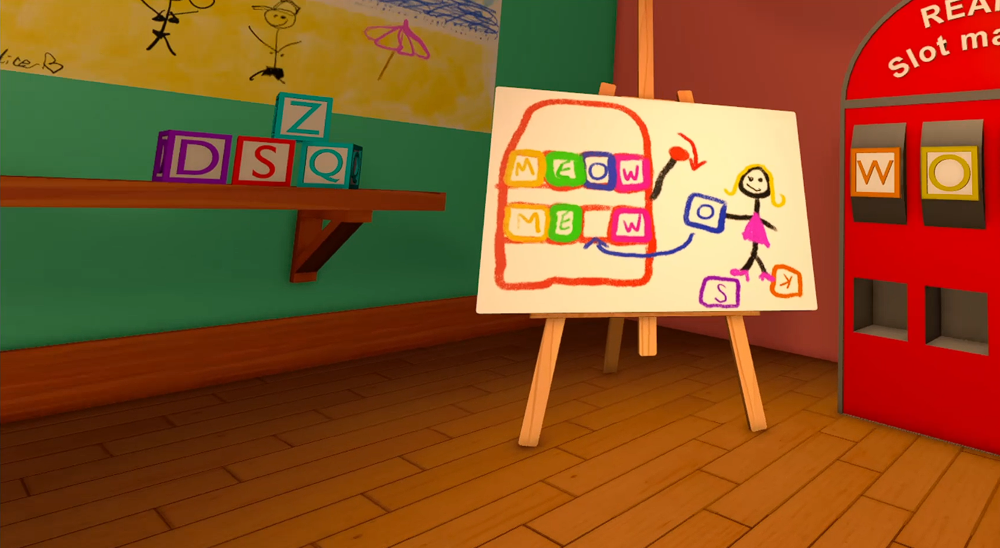
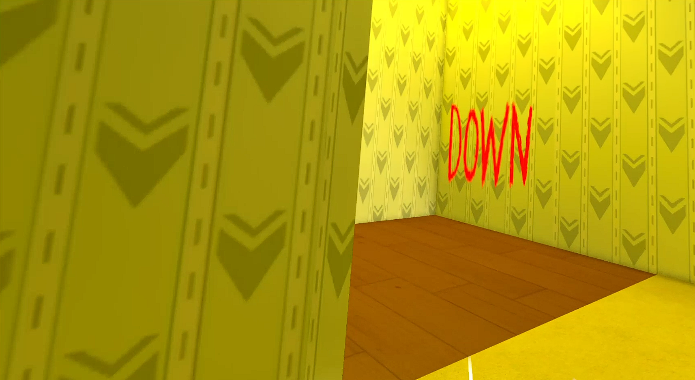
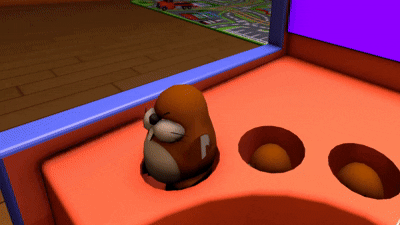

# Baby Steps

<p float="left">
    
    
    
</p>

Un jeu en réalité virtuelle où vous incarnez un enfant dans une garderie transformée en centre de test, guidé par une intelligence artificielle.

Projet de 4e année réalisé à l'ENSIM dans le cadre de **RéaMix 2025-26** (Réalité Mixte pour la Formation et l'Ingénierie), par une équipe de six étudiants. Le rapport complet est disponible : [rapport_fin_projet.pdf](rapport_fin_projet.pdf).

## Captures d'écran

<p float="left">
  
  
</p>

<p align="center">
    
</p>

## But du jeu

Baby Steps est un **jeu d'initiation à la VR** pour les joueurs qui n'ont jamais porté de casque. Chaque mini-jeu introduit une mécanique de base : se déplacer, attraper, lancer, manipuler. Le joueur incarne un enfant enfermé dans des salles de test et guidé par une IA qui cherche à le rendre obéissant. À lui de suivre ses ordres ou non.

## Fonctionnalités

- Deux salles aux ambiances opposées : une garderie colorée et un labyrinthe inspiré des Backrooms
- Mini-jeux : lancer de balles, slot machine, Whack-a-Mole, Simon Says, Black Jack
- Déplacement fluide au joystick avec rotation par angle (*snap turn*) pour limiter le *motion sickness*
- Objets attrapables sous n'importe quel angle (sauf certains, comme le marteau, qui ont une prise prédéfinie)
- Assistance à l'insertion pour la slot machine : un hologramme montre l'emplacement et le cube s'y aimante (*snap*) une fois relâché
- Menus intégrés au monde 3D, utilisables avec un rayon depuis la manette, avec occultation de l'environnement (*fog of war*) pendant leur utilisation
- Retours visuels (surbrillance des objets interactifs), sonores (sons 2D et 3D spatialisés) et haptiques (vibrations des manettes)
- Dialogues de l'IA déclenchés par les événements de jeu, tutoriels animés des manettes

## Architecture technique

- **Moteur** : Unity 2022.3.9f1 avec XR Interaction Toolkit 2.5.4, OpenXR et Oculus XR
- **Casque** : Meta Quest, testé via Meta Quest Link
- **Système d'événements** : le jeu repose sur l'observer pattern. Des `GameEvent` (ScriptableObjects dans [Assets/GameEvents](Assets/GameEvents)) sont déclenchés par les objets et écoutés par des `GameEventListener`. Par exemple, le panier émet « balle dans panier » sans connaître la télévision ni la porte, qui réagissent chacune de leur côté. Cela a permis à chacun de travailler en boîte noire, puis de brancher les dialogues sur les événements existants en quelques clics.
- **AudioSystem** : un objet unique centralise tous les sons et leurs paramètres (clip, volume, pitch).
- **Prefabs** : chaque objet est transformé en prefab pour limiter les modifications du fichier de scène et donc les conflits Git.

Les scripts sont dans [Assets/_Scripts](Assets/_Scripts), avec un dossier par mini-jeu ou système.

## Assets créés

La plupart des assets ont été **modélisés par l'équipe sous Blender**, notamment ceux de la salle 1. Certains ont été importés depuis l'Asset Store. Le style est mi-cartoon, mi-réaliste, et les modèles sont volontairement *low-poly* pour rester légers sur un casque VR.

Les fichiers `.fbx` sont dans [Assets/Imports](Assets/Imports) et les prefabs dans [Assets/Prefabs](Assets/Prefabs).

| Catégorie | Modèles |
| --- | --- |
| Personnage | Personnage principal (avatar humanoïde *low-poly*), mains du joueur |
| Bâtiment | Charpente du toit, plinthes, portes de séparation entre les salles (animées) |
| Salle 1 : mobilier | Parc pour bébé à porte coulissante, chaise en bois, chaise en plastique, table, table basse, bibliothèque, étagère, pupitre, canapé pour bébé, tableau |
| Salle 1 : jouets et déco | Balles de jonglage, planétarium (animé), veilleuse (animée), télévision (visage de l'IA) |
| Salle 1 : mini-jeux | Tuyau distributeur de balles et panier, slot machine avec manivelle, 26 cubes-lettres (A à Z), Whack-a-Mole (animé) avec ses taupes et son marteau |
| Salle 2 | Labyrinthe, ascenseur, escalier en colimaçon, barrière et dalles d'étage, lampes (enfant, plafond), tapis pour enfant, chaise excentrique |
| Salle 2 : mini-jeux | Table de Black Jack |
| Menus | Manettes VR animées (tutoriels), panneau de menu en carton |

- **Animations** ([Assets/Animations](Assets/Animations)) : portes, ascenseur, taupes, planétarium, veilleuse, mains et manettes VR. Les animations des portes et mécanismes ont été créées dans Blender.
- **Textures** : les matériaux Blender ont été **bakés en images** avant l'export, car Unity n'interprète pas les nœuds procéduraux de Blender. S'y ajoutent les dessins explicatifs, les tags des murs du labyrinthe et les écrans de la télévision ([Assets/Textures](Assets/Textures)). La salle 2 utilise un éclairage précalculé (*baked lighting*).
- **Son** : dialogues de l'IA écrits par l'équipe et interprétés par Maya Hamdy ([Assets/Audio/Son/Dialogues](Assets/Audio/Son/Dialogues)), bruitages issus de banques de sons libres de droits.

## Structure du dépôt

```
.
├── Assets
│   ├── Animations  # Animation controllers et fichiers d'animations
│   ├── AssetStore  # Ressources provenant du Unity Asset Store
│   ├── Audio       # Sons, dialogues et paramètres du mixer
│   ├── Fonts
│   ├── GameEvents  # Évènements utilisés dans l'éditeur et dans le code
│   ├── Imports     # Modèles fbx créés sous Blender
│   ├── Lighting    # Fichiers concernant la veilleuse (textures)
│   ├── Materials   # Fichiers matériaux définissant l'apparence des modèles
│   ├── Prefabs
│   ├── Samples     # Répertoire fourni par XR Interaction Toolkit
│   ├── Scenes      # Salle1 et Salle2
│   ├── _Scripts    # Scripts C# (un dossier par mini-jeu / système)
│   ├── Settings    # Fichiers paramètres pour la pipeline 3D
│   ├── TextMesh Pro
│   ├── Textures    # Images pour les modèles
│   ├── XR          # Fichiers paramètres pour la lib XR
│   └── XRI         # Fichiers paramètres pour la lib XR Interaction
├── Packages        # Fichiers répertoriant les dépendances utilisées
├── ProjectSettings # Fichiers paramètres du projet
├── README.md
├── rapport_fin_projet.pdf
└── screenshots     # Captures d'écran dans le README
```

## Exécuter localement

Clonez le projet

```bash
  git clone https://github.com/eric-lefebvre/unity_vr_ensim_babysteps.git
```

Puis ouvrez le projet sur Unity Hub avec l'éditeur en version **2022.3.9f1**. Lancez la scène `Assets/Scenes/Salle1.unity` avec un casque Meta Quest connecté via Meta Quest Link.

> En cas d'erreurs de compilation à l'ouverture, supprimez le dossier `Library` et laissez Unity le régénérer.

## Équipe

Eric-Nicolas Brieau, Maya Hamdy, Eric Lefebvre, Clément Moquereau, Matéo Olivier, Enzo Sarkissian

Tuteurs : Madeth May, Corentin Coupry (Le Mans Université)
